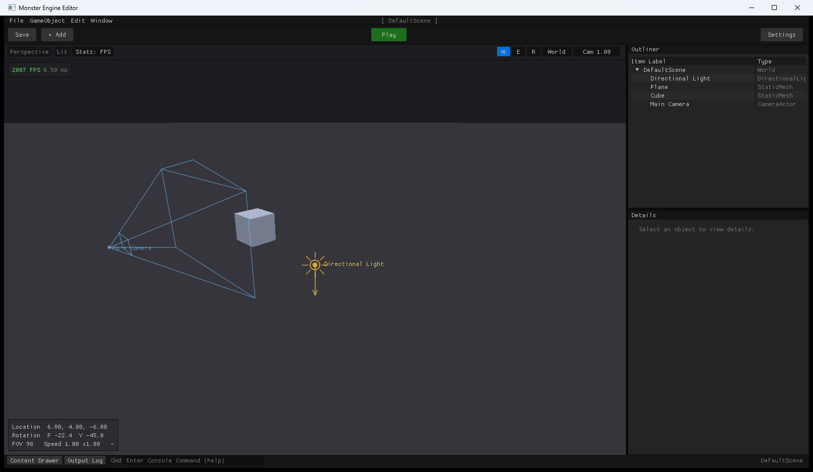
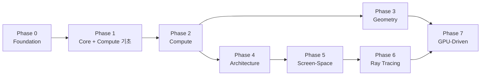

<div align="center">

# 👹 Monster Engine — DirectX 12 Study

**DirectX 12를 바닥부터 — 창 하나 띄우기에서 레이 트레이싱까지, 38개 Section으로**




</div>

DX11 학습 엔진을 출발점으로, 렌더러를 **DirectX 12로 다시 쓰면서** 그래픽스 테크닉을 Section 단위로 하나씩 쌓아 가는 학습 프로젝트입니다.
Section이 완료될 때마다 **실행 파일(데모 + 검증 테스트)** 을 [Releases](https://github.com/earltrash/DX-12-Study/releases)에 올립니다.

- 🧪 **자동 검증** — 각 Section 결과를 `Tests.exe`가 수치로 확인 (픽셀 리드백, 펜스 타이밍, CPU 레퍼런스 비교 …). Release에 함께 포함
- 🐞 **Debug Layer 에러 0** — 모든 Section 테스트 동안 D3D12 Debug Layer ERROR/CORRUPTION 0건
- 🧬 **뮤테이션 확인** — 일부러 버그를 넣어 테스트가 정말 FAIL하는지 확인, 못 잡는 경우는 문서에 명시
- 📏 **측정 기반 비교** — GS vs Mesh Shader, 섀도맵 vs RT 섀도, SSR vs RT 반사 … 같은 장면 · GPU 타이밍으로
- 🔍 **UE5 대조** — 각 기법이 Unreal Engine 5 `D3D12RHI` / 렌더러의 어디에 해당하는지 기록

---

## 📚 Sections

> 상태: ✅ 완료 · 🚧 진행 중 · ⬜ 예정  ·  ⚡ DX11에서 구현해 본 기능의 이식 · 🆕 새로 배우는 기능
> **각 Section의 설명 · 목적 · 기대 · 결과(검증 기준) → [docs/SECTIONS.md](docs/SECTIONS.md)** (공개 강의·책·샘플 13종의 커리큘럼과 비교해 구성)

### Phase 0 · Foundation
| # | Section | 핵심 | 상태 | 실행 파일 |
|---|---|---|---|---|
| 00 | [Foundation — DX11 엔진 & UE5 스타일 에디터](docs/sections/S00-foundation.md) ⚡ | 컴포넌트·직렬화·FBX/스키닝 검증, 씬 밖 에디터 카메라 | ✅ | 준비 중 |

### Phase 1 · Core — DX11 드라이버가 숨기던 것들
| # | Section | 핵심 | 상태 | 실행 파일 |
|---|---|---|---|---|
| 01 | [Window · Clear · Present](docs/sections/S01-clear-present.md) 🆕 | Device/Queue/SwapChain, Fence, 프레임 인 플라이트 | 🚧 | — |
| 02 | Hello Triangle 🆕 | Root Signature, PSO, DXC, Upload→Default 복사, 깊이 버퍼, Agility SDK | ⬜ | — |
| 03 | GPU Timing & Debug 🆕 | Timestamp Query, PIX, DRED — 이후 모든 Section의 측정 도구 | ⬜ | — |
| 04 | Compute 기초 🆕 | Dispatch·스레드 ID·UAV·UAV 배리어, PS와 비교, 그룹 크기 실험 | ⬜ | — |
| 05 | Constants · Instancing · Upload Ring 🆕 | `Map(DISCARD)` 대체, Root Const/CBV/Table, 인스턴싱, GPU Upload Heap(ReBAR) | ⬜ | — |
| 06 | Textures · Descriptor Allocator 🆕 | 텍스처 업로드 정렬, sRGB, CPU staging + GPU 링 디스크립터 힙 | ⬜ | — |
| 07 | DX11 기능 이식 — PBR · HDR · Skinning ⚡ | + 블렌딩·스텐실·MSAA Resolve, DX11 결과와 픽셀 비교 | ⬜ | — |
| 08 | Shadow Mapping (CSM) 🆕 | 캐스케이드 분할, 텍셀 스냅, PCF — RT 섀도 비교 기준선 | ⬜ | — |

### Phase 2 · Compute Shader — 하드웨어 모델 → 응용
| # | Section | 핵심 | 상태 | 실행 파일 |
|---|---|---|---|---|
| 09 | groupshared & 동기화 | 분리형 블러, 온칩 공유 메모리, 뱅크 충돌, 점유율 | ⬜ | — |
| 10 | Reduction & Atomics | 휘도 히스토그램 → 자동 노출, 원자 연산 경합 | ⬜ | — |
| 11 | Wave Intrinsics & Prefix Sum | 웨이브 연산, 병렬 스캔, Stream Compaction | ⬜ | — |
| 12 | Compute Utilities | Mip 생성, IBL 사전 계산 (Irradiance / Prefilter / BRDF LUT) | ⬜ | — |
| 13 | Compute Skinning | 한 번 스키닝 → 메인·섀도·RT BLAS 재사용 | ⬜ | — |
| 14 | GPU Particles | Emit/Simulate/Compact, Indirect Draw, Bitonic 정렬 | ⬜ | — |
| 15 | GPU Culling & ExecuteIndirect | 절두체 + Hi-Z 2-phase 컬링, CPU가 드로우를 내리지 않음 | ⬜ | — |
| 16 | Tiled / Clustered Lighting | Froxel 라이트 배정, 라이트 1000개 | ⬜ | — |

### Phase 3 · Geometry Pipeline
| # | Section | 핵심 | 상태 | 실행 파일 |
|---|---|---|---|---|
| 17 | Geometry Shader | 노멀 시각화·와이어프레임·퍼 셸·큐브맵 단일 패스, 왜 느린지 측정 | ⬜ | — |
| 18 | Tessellation | Hull/Domain, 크랙 없는 화면 공간 LOD 지형 | ⬜ | — |
| 19 | Mesh & Amplification Shader | Meshlet + 콘/절두체 컬링, GS vs 정점 파이프라인 vs MS 타이밍 | ⬜ | — |

### Phase 4 · Engine Architecture
| # | Section | 핵심 | 상태 | 실행 파일 |
|---|---|---|---|---|
| 20 | Memory Management | Heap 타입, Placed/Aliasing, D3D12MA, Residency, 예산 | ⬜ | — |
| 21 | Bindless & PSO Cache | SM 6.6 `ResourceDescriptorHeap`, PipelineLibrary, 핫리로드 | ⬜ | — |
| 22 | Render Graph | 자동 배리어, 트랜지언트 앨리어싱, 패스 컬링 | ⬜ | — |
| 23 | Deferred Shading ⚡ | G-Buffer, Forward+와 비교 | ⬜ | — |
| 24 | Async Compute & 멀티스레드 기록 | 다중 큐·큐 간 펜스, 병렬 CommandList 기록 | ⬜ | — |

### Phase 5 · Screen-Space (RT 비교 기준선)
| # | Section | 핵심 | 상태 | 실행 파일 |
|---|---|---|---|---|
| 25 | SSAO (GTAO) | RTAO 비교 기준선 | ⬜ | — |
| 26 | SSR | Hi-Z 레이 마칭, RT 반사 비교 기준선 | ⬜ | — |

### Phase 6 · Ray Tracing
| # | Section | 핵심 | 상태 | 실행 파일 |
|---|---|---|---|---|
| 27 | DXR 기초 | BLAS/TLAS, State Object, Shader Table, Any Hit, Intersection Shader | ⬜ | — |
| 28 | Dynamic Acceleration Structures | TLAS 갱신, 스키닝 BLAS refit vs rebuild | ⬜ | — |
| 29 | RT Shadow & AO | Inline Ray Query — CSM·GTAO와 비교 | ⬜ | — |
| 30 | RT Reflections & Denoising | SVGF 계열 디노이저 — SSR과 비교 | ⬜ | — |
| 31 | Path Tracer | NEE·MIS, White Furnace — 모든 결과의 정답 이미지 | ⬜ | — |
| 32 | ReSTIR DI | 라이트 1000개 직접광, 시공간 재사용 | ⬜ | — |
| 33 | DDGI | 프로브 기반 실시간 GI | ⬜ | — |
| 34 | DXR 1.2 — SER & OMM | 셰이더 실행 재정렬, Opacity Micromaps | ⬜ | — |

### Phase 7 · Modern GPU-Driven
| # | Section | 핵심 | 상태 | 실행 파일 |
|---|---|---|---|---|
| 35 | Visibility Buffer | 삼각형 ID → 재질 해석, Deferred와 비교 | ⬜ | — |
| 36 | TAA & Temporal Upscaling | 지터·모션 벡터·히스토리 클램핑 | ⬜ | — |
| 37 | Work Graphs | GPU가 스스로 작업 생성, ExecuteIndirect와 비교 | ⬜ | — |



---

## ▶ 실행
1. [Releases](https://github.com/earltrash/DX-12-Study/releases)에서 원하는 Section의 zip을 받아 압축 해제
2. 데모 실행 파일 실행 (Section 문서에 조작법)
3. `Tests.exe` 실행 → 해당 Section 검증 결과 출력 (종료 코드 = FAIL 수)

**요구 사항**: Windows 10/11 x64, DirectX 12 GPU (Feature Level 12_0+). Mesh Shader(S19)·DXR(S27~)은 12_2 / DXR 지원 GPU, SER·OMM(S34)은 최신 드라이버 필요.
개발 환경: RTX 5060 Laptop · Visual Studio 2022 · C++17 · DXC

## 📂 구성
```
docs/
├── SECTIONS.md          # 38개 Section의 설명 · 목적 · 기대 · 결과(검증 기준) · 참고 자료
├── sections/SXX-*.md    # 완료된 Section별 구현 기록 · 테스트 결과 · 스크린샷
└── images/
```
